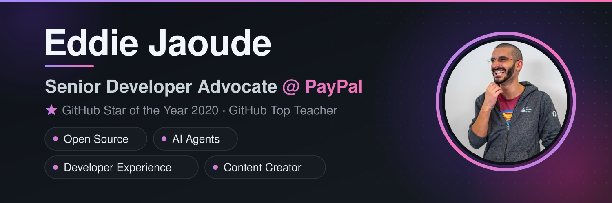

<a href="https://eddiejaoude.substack.com/p/links">
  <picture>
    <source media="(prefers-color-scheme: dark)" srcset="assets/banner-dark.svg">
    <source media="(prefers-color-scheme: light)" srcset="assets/banner-light.svg">
    
  </picture>
</a>

  
  
  
  
  

## 🚀 What I'm doing now

- 💼 **Senior Developer Advocate at PayPal**: helping developers build with [@paypaldev](https://github.com/paypaldev) and [developer.paypal.com](https://developer.paypal.com/)
- 🤖 **Building with AI agents**: Claude, Orca, voice-controlled agents and MCP servers, all shared on [YouTube](https://www.youtube.com/@eddiejaoude)
- ✍️ **Writing [Eddie's Log](https://eddiejaoude.substack.com)**: Open Source, developer experience, hackathons and building SaaS with AI

## 🏆 Recognition

- ⭐ **GitHub Star of the Year** at Nova 2020 ([announced by GitHub](https://twitter.com/github/status/1333923873713233922))
- 🌱 **GitHub Stars Community Growth award** at Nova 2021 ([GitHub Stars alumni](https://stars.github.com/alumni))
- 👨‍🏫 **GitHub Stars Top Teacher award** at Nova 2022 ([GitHub Stars alumni](https://stars.github.com/alumni))
- 🚀 **GitHub Accelerator 2023** for [BioDrop](https://github.com/EddieHubCommunity/BioDrop)

<table>
  <tr>
    <td align="center" width="50%">
       
      <strong>Nova 2021: Community Growth</strong>
    </td>
    <td align="center" width="50%">
       
      <strong>Nova 2022: Top Teacher</strong>
    </td>
  </tr>
</table>

## 📈 Track record

| Project | What | Impact |
| --- | --- | --- |
| [BioDrop](https://github.com/EddieHubCommunity/BioDrop) | Founded the Open Source link-in-bio platform, backed by GitHub Accelerator 2023 | 5.6k★ · 4k forks · sunset Jun 2024 |
| [EddieHub](https://github.com/EddieHubCommunity) | Founded an inclusive community built on "Collaboration 1st, Code 2nd" | Grew to 15k+ members before closing |
| [awesome-github-profiles](https://github.com/EddieHubCommunity/awesome-github-profiles) | Showcased the community's GitHub profiles (archived) | 1.5k★ |

### 🎥 Latest YouTube videos

<table>
<!-- YOUTUBE-VIDEOS-LIST:START --><tr><td width="30%"></td>
<td><a href="https://www.youtube.com/watch?v=VS2a_0Cp4A4">Optimize your Postgres with pg-aiguide MCP server</a></td></tr>
<tr><td width="30%"></td>
<td><a href="https://www.youtube.com/watch?v=EaNsGFBf97o">Monitor your website with the Open Source project Kestra</a></td></tr>
<tr><td width="30%"></td>
<td><a href="https://www.youtube.com/watch?v=Qa0ZgJJjJVI">How to contribute to Open Source? Full example on the Kestra GitHub Repo</a></td></tr>
<!-- YOUTUBE-VIDEOS-LIST:END -->
</table>

#### ⚡ Latest Shorts

<table>
<tr>
<!-- YOUTUBE-SHORTS-LIST:START --><td align="center" valign="top" width="33%"> <a href="https://www.youtube.com/shorts/xSUaMgD7cWk">Voice to manage all your agents</a></td>
<td align="center" valign="top" width="33%"> <a href="https://www.youtube.com/shorts/Bo69v3BOwOU">Will Claude AI replace developers?</a></td>
<td align="center" valign="top" width="33%"> <a href="https://www.youtube.com/shorts/9f_TApH4_6Q">Building with AI away from my computer using Orca + Claude</a></td>
<!-- YOUTUBE-SHORTS-LIST:END -->
</tr>
</table>

More quick tips on AI agents and Open Source in my [YouTube Shorts](https://www.youtube.com/@eddiejaoude/shorts).

### ✍️ Latest from my blog

<ul>
<!-- BLOG-POST-LIST:START -->
<li><a href="https://eddiejaoude.substack.com/p/how-to-win-a-hackathon-spoiler-its">How to win a hackathon (spoiler: it’s not your code)</a></li>
<li><a href="https://eddiejaoude.substack.com/p/newsletter-v03-can-a-tools-dx-really">Newsletter v0.3: Can a tool&apos;s DX really improve my productivity?</a></li>
<li><a href="https://eddiejaoude.substack.com/p/context-and-the-experience-is-everything-screen-recording-pro-video-recorder-launch">Newsletter v0.2: Context and the experience is everything!</a></li>
<li><a href="https://eddiejaoude.substack.com/p/contributing-to-enterprise-open-source-github">Contributing to an Enterprise Open Source Project: Kestra</a></li>
<!-- BLOG-POST-LIST:END -->
</ul>

## 💬 What people say

> Star of the Year at Nova 2020 is @eddiejaoude! ⭐ Eddie contributes to the community through his GitHub & open source videos, inspiring current & future Stars, and providing feedback via the program!
>
> **[@github](https://twitter.com/github/status/1333923873713233922)**, announcing GitHub Star of the Year

> y'all should follow @eddiejaoude. he puts so much positive energy into the world. love that guy. he's always trying to support other people and lift them up.
>
> **[James Governor (@monkchips)](https://twitter.com/monkchips/status/1364550984106717190)**, co-founder of RedMonk

> You are an example for the whole community, keep up the good work Eddie
>
> **[Patrick Debois](https://www.linkedin.com/feed/update/urn:li:activity:6711225360224202752?commentUrn=urn%3Ali%3Acomment%3A%28activity%3A6711225360224202752%2C6711645968451829760%29)**, founder of DevOpsDays

> Eddie is probably the most genuine and kind person I know in tech 🥰 providing opportunities and consistently cheering without expecting anything in return! He just recommended me for a podcast 😱
>
> **[Anaïs Urlichs](https://twitter.com/urlichsanais/status/1349358736092094467)**

## 💖 Sponsors

A huge thank you to my sponsors for supporting my Open Source work 🙏

  
  
  
  
  

💖 **[Become a sponsor](https://github.com/sponsors/eddiejaoude)** and help me keep making tech content.

---

🔗 All my social links and courses in one place: <a href="https://eddiejaoude.substack.com/p/links">eddiejaoude.substack.com/p/links</a>

